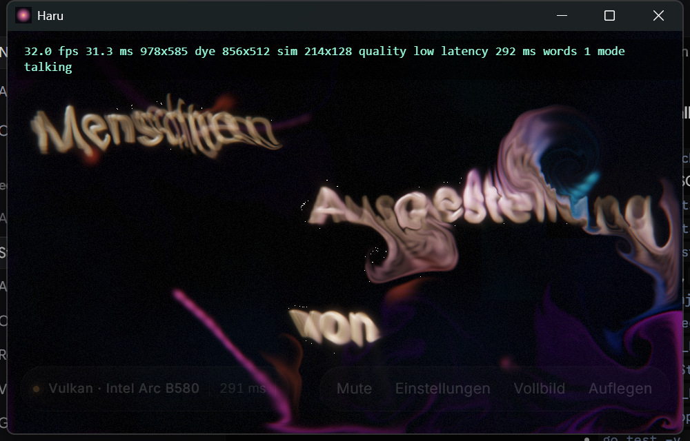
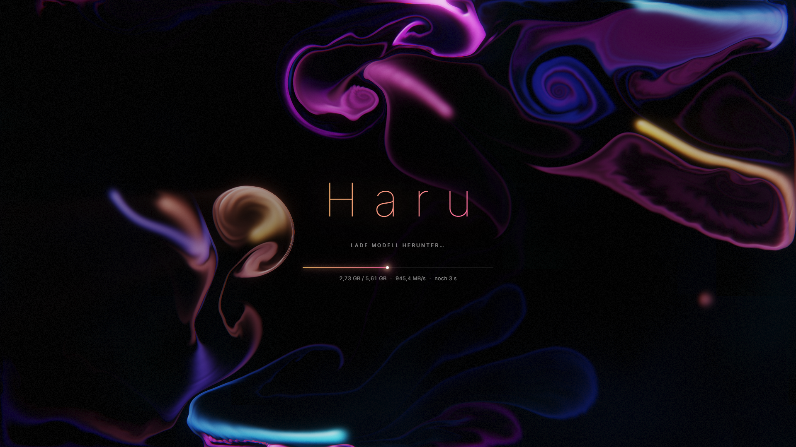
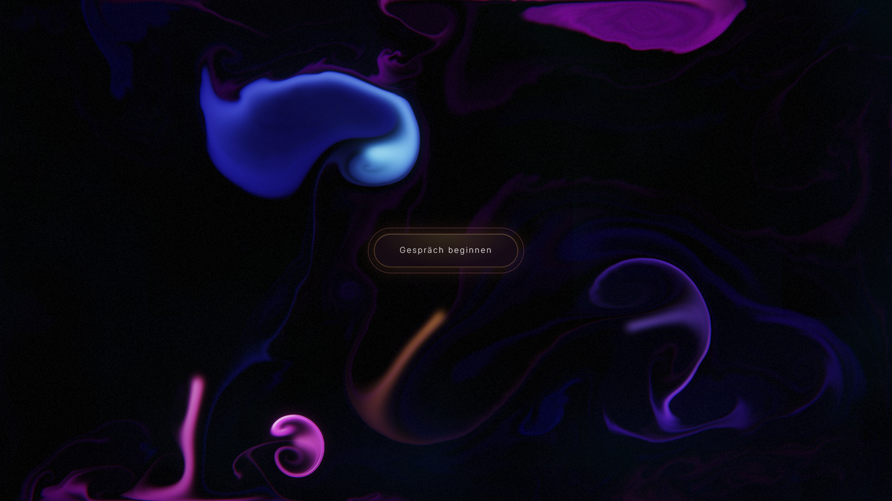
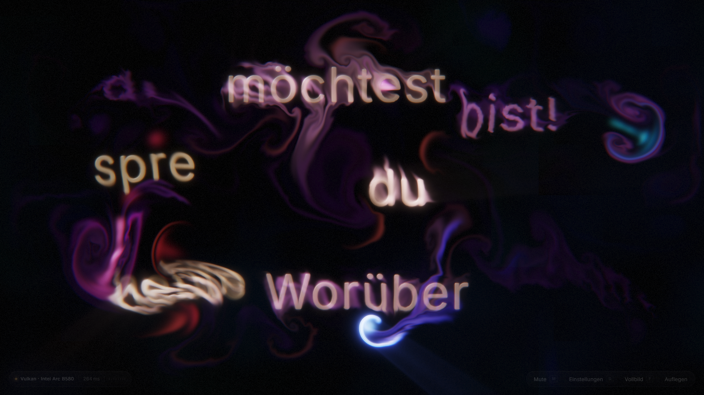
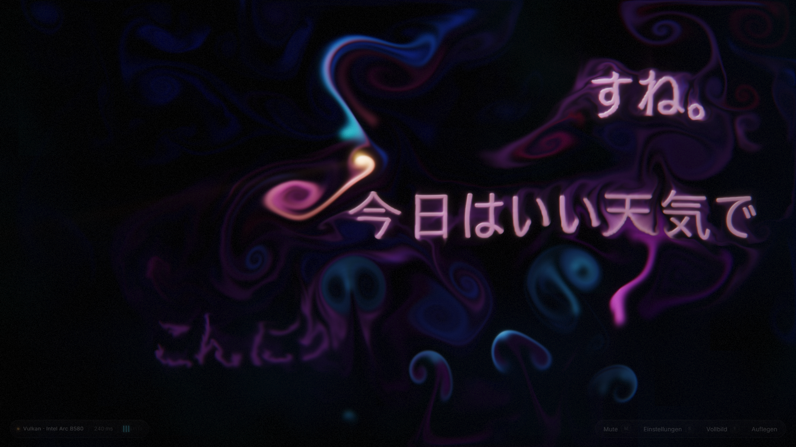

# Haru – Flüssiges Licht

Eine Desktop-App für ein Gespräch in Echtzeit mit dem Sprachmodell **Haru-4B**. Du sprichst über dein Mikrofon, Haru antwortet mit Stimme, und jedes Wort, das Haru spricht, erscheint als glühende Tinte in einer WebGL2-Fluidsimulation.

Haru läuft lokal: Die App startet den `speech worker` aus [speech.cpp](https://github.com/nyosegawa/speech.cpp) v0.11.1 als Kindprozess und nutzt die GPU (Vulkan oder CUDA), mit CPU als letzter Option.



## Funktionen

- **Full-Duplex-Gespräch:** Du und Haru können gleichzeitig sprechen. Das Mikrofon wird in 20-ms-Blöcken an den Worker geschickt, Harus Antwort läuft fortlaufend ab.
- **Echounterdrückung:** Über Lautsprecher entfernt Haru die eigene Stimme aus dem Mikrofonsignal (sonora, ein Rust-Port des WebRTC-Audioprozessors: AEC3, Rauschunterdrückung, AGC2, Hochpass). Unterbrechen und Zwischenlaute wie „mhm“ bleiben möglich.
- **Flüssiges Licht:** Harus Worte werden als Tinte in eine Stable-Fluids-Simulation gespritzt, mit Bloom, God Rays, Flüssigglas-Shading und ACES-Tonemapping.
- **Audio-Kopplung:** Harus Lautstärke steuert Wirbel und Splats, der spektrale Schwerpunkt den Farbton. Dein Mikrofon malt kühle Splats vom unteren Rand („Haru hört zu").
- **Automatische Backend-Wahl** (CUDA, Vulkan, CPU) mit Anzeige im HUD, Resumable Modell-Download, adaptive Render-Qualität, optionale Untertitel.
- **Sprache:** Eine Einstellung steuert Oberfläche und Gespräch. Beim ersten Start übernimmt Haru die Sprache des Betriebssystems, unterstützt werden Deutsch, English, Español, Français, 日本語, 한국어, Português, Русский und 中文 (vereinfacht). Details unter [Sprache](#sprache).

Screenshots:

| Start | Leerlauf | Gespräch | Japanisch |
|---|---|---|---|
|  |  |  |  |

## Voraussetzungen

**Zum Benutzen (Installer):**

- Windows 10 oder 11, 64 Bit
- GPU mit **Vulkan 1.3** oder eine **NVIDIA-GPU mit CUDA** (CUDA-Treiber vorhanden) mit mindestens **8 GB** Grafikspeicher
- Kopfhörer oder Lautsprecher (Kopfhörer klingen am besten)
- ca. **7 GB** freier Speicherplatz für das Modell

**Zum Bauen aus dem Quellcode:**

- Visual Studio 2022 oder neuer mit dem C++-Toolset
- CMake ≥ 3.20
- Vulkan SDK
- Rust (stable)
- Node.js 20 oder neuer (die CI nutzt Node 24)
- Für die CUDA-Variante zusätzlich das CUDA Toolkit 12.x (`CUDA_PATH` gesetzt)

## Installation

Die fertige Installationsdatei kommt aus dem CI-Lauf: Im GitHub-Actions-Lauf des Workflows `build` liegt das Artefakt `haru-windows-x64-nsis`. Enthalten ist `Haru_0.1.0_x64-setup.exe`. Der Installer legt die Backend-Varianten unter `backends\` im Installationsordner ab.

Alternativ selbst bauen, siehe [Aus dem Quellcode bauen](#aus-dem-quellcode-bauen).

## Erster Start

1. Haru erkennt die verfügbaren Backends (Boot-Screen).
2. Falls das Modell fehlt, lädt Haru es herunter (6,6 GB, Fortschritt als glühende Linie mit Geschwindigkeit und Restzeit). Danach wird es geprüft (SHA256). Ein Abbruch ist unkritisch: Beim nächsten Start setzt der Download an der gleichen Stelle fort.
3. Das Modell landet im Cache von speech.cpp, zusammen mit dem speech-CLI:

   ```
   %LOCALAPPDATA%\speech.cpp\models\sakasegawa--Haru-4B-GGUF\c372a527e63ca4251429a48863535b8bca03ebd6f414bbf31f28a9d175349934\Haru-4B-Q8_0.gguf
   ```

   Eine frühere Q6_K-Datei bleibt im gemeinsamen speech.cpp-Cache liegen. Haru löscht sie nicht; sie lässt sich von Hand entfernen. Löscht die Deinstallation das Modell mit (siehe Deinstallation unten), entfällt sie ebenfalls, da sie im selben Modellordner liegt.

   Mit `SPEECH_MODEL_DIR=<absoluter Pfad>` (Umgebungsvariable) wird der Modellordner ersetzt. Ein relativer Pfad wird abgelehnt.
4. Beim allerersten Start erscheint ein Hinweis: Kopfhörer klingen am besten, über Lautsprecher sorgt die Echounterdrückung dafür, dass Haru sich nicht selbst hört. Danach drückst du **Start**.

Die Oberfläche erscheint beim ersten Start in der Sprache des Betriebssystems, sofern sie unterstützt wird, sonst auf Englisch (siehe [Sprache](#sprache)).

**Deinstallation:** Das Deinstallationsprogramm fragt am Ende, ob das Haru-Modell (ca. 6,6 GB) ebenfalls gelöscht werden soll. Die Standardantwort ist Nein. Bleibt das Modell erhalten, muss eine neue Installation es nicht erneut herunterladen.

Gelöscht wird nur der Modellordner von Haru: `%LOCALAPPDATA%\speech.cpp\models\sakasegawa--Haru-4B-GGUF` (bzw. derselbe Ordner unter `SPEECH_MODEL_DIR`, falls gesetzt). Andere Modelle und der übrige speech.cpp-Cache bleiben erhalten. Leere Ordner `models` und `speech.cpp` am Standardort werden entfernt.

Bei einem Update (Deinstallationsprogramm mit `/UPDATE`) wird nie gefragt und das Modell nie gelöscht. Auch stille (`/S`) und passive (`/P`) Deinstallationen fragen nicht; dort wird das Modell nur mit dem Parameter `/DELETEMODEL` entfernt, zum Beispiel `uninstall.exe /S /DELETEMODEL`.

Die Option zum Löschen der Anwendungsdaten im Deinstallationsprogramm ist davon getrennt: Sie entfernt `settings.json` und die Datenordner der App, nicht das Modell.

## Bedienung

| Taste | Funktion |
|---|---|
| **M** | Mikrofon stummschalten (gilt für das laufende und die folgenden Gespräche, wird nicht gespeichert) |
| **S** | Einstellungen öffnen |
| **F** | Vollbild umschalten |

Das HUD zeigt Backend-Badge (z. B. „Vulkan · Intel(R) Arc(TM) B580 Graphics"), Latenz, Mikrofonpegel sowie Tasten für Mute, Einstellungen und Vollbild.

### Einstellungen

Gespeichert als `settings.json` im App-Config-Ordner (unter Windows `%APPDATA%\dev.haru.fluidlight\settings.json`). Nur explizit gesetzte Optionen gehen an den Worker.

| Schlüssel | Standard | Bedeutung |
|---|---|---|
| `language` | Betriebssystem, sonst `"en"` | Sprache der Oberfläche und des Gesprächs (Feld „Sprache“): de, en, es, fr, ja, ko, pt, ru, zh |
| `name` | `"Haru"` | Name, den Haru verwendet. Leer oder `"Haru"` = Name der Karte (Japanisch: ハル) |
| `gender` | `null` | `"female"` oder `"male"` |
| `backchannel` | `null` | Zwischenlaute: `"low"`, `"mid"`, `"high"`. `null` = Wert der offiziellen Karte (`mid`) |
| `speakFirst` | `true` | Haru beginnt das Gespräch |
| `temperature` | `0.6` | Kreativität, 0,3 bis 1,0 (höher: Haru redet mehr und hört weniger zu) |
| `topK` | `25` | Top-k-Sampling, 0 bis 500 |
| `voicePath` | `null` | Optionale WAV-Datei für die Stimme |
| `inputDevice` | `null` | Mikrofon (`null` = Standardgerät) |
| `outputDevice` | `null` | Ausgabegerät (`null` = Standardgerät) |
| `backend` | `"auto"` | `auto`, `cuda`, `vulkan`, `metal`, `cpu` |
| `device` | `"auto"` | `auto` oder ein Name aus `speech devices` (z. B. `Vulkan0`) |
| `quality` | `"auto"` | `auto`, `low`, `medium`, `high`, `ultra` |
| `subtitles` | `false` | Untertitel einblenden |
| `lagLimitSecs` | `1.0` | Rückstandsgrenze in Sekunden, 0,5 bis 10 |
| `echoCancellation` | `true` | Echounterdrückung (Harus Stimme aus dem Mikrofon entfernen). Wirkt ab dem nächsten Gespräch; `false` schickt das Mikrofonsignal unverändert an das Modell. Fehlt der Schlüssel in einer alten `settings.json`, gilt `true`. |

Änderungen an `backend`, `device` oder `voicePath` laden das Modell neu.

### Sprache

Die Einstellung `language` steuert die ganze Oberfläche (Startbildschirm, Hinweise, Einstellungen, Fehlermeldungen) und die Sprache, in der Haru spricht (Charakterkarte und Gespräch).

Unterstützt werden Deutsch (`de`), English (`en`), Español (`es`), Français (`fr`), 日本語 (`ja`), 한국어 (`ko`), Português (`pt`), Русский (`ru`) und 中文 (`zh`, vereinfachtes Chinesisch).

- **Erster Start:** Ohne `settings.json` oder mit einer unlesbaren bzw. beschädigten Datei (die dann als `settings.json.bad` gesichert wird) nimmt Haru die erste unterstützte Sprache aus den bevorzugten Sprachen des Betriebssystems. Regionale Varianten zählen zur Grundsprache (`de-AT` → `de`, `pt-BR` → `pt`, `zh-TW` → `zh`). Ist keine Sprache des Betriebssystems unterstützt, nimmt Haru Englisch.
- **Ändern:** Nach dem Speichern in den Einstellungen wird die Oberfläche sofort in der neuen Sprache angezeigt. Ein laufendes Gespräch behält seine Sprache, die neue gilt ab dem nächsten Gespräch.
- **Speichern:** Die gewählte Sprache steht ab dem ersten Speichern in `settings.json`, zum Beispiel wenn du den Kopfhörer-Hinweis bestätigst.

### Charakterkarte

Haru nutzt die Karte der gewählten Persona (siehe [Personas: Engel und Dämon](#personas-engel-und-dämon)). Ein eigener Name oder ein eigener Zwischenlaut-Wert überschreibt die Karte. Ein eigener Name ersetzt außerdem „Haru“ in den Kartentexten.

### Gesprächsabschnitte

Der Speicher für das Gedächtnis des Modells (KV-Cache) wächst mit jeder Sekunde Gespräch. Haru liest vor jedem Abschnitt den freien Speicher des Geräts und wählt die Länge: (freier Speicher − 512 MiB bei GPU bzw. 1 GiB bei CPU) / 500 kB pro Sekunde, begrenzt auf 120 bis 3600 s. Unter Windows stammt der freie GPU-Speicher aus dem systemweiten GPU-Speicherzähler (DXGI + PDH), sonst aus der Geräteliste von speech.cpp. Ist der Abschnitt zu Ende, beginnt Haru automatisch frisch (ohne Neuladen des Modells), ein Hinweis erscheint kurz oben, und Haru antwortet nach ein bis zwei Sekunden wieder. Was im vorigen Abschnitt gesagt wurde, kennt Haru dann nicht mehr. `HARU_MAX_SECONDS` setzt die Abschnittslänge fest (nur zum Testen).

### Render-Qualität

Auflösungen (Simulation / Farbfeld): low 128 / 512, medium 192 / 1024, high 256 / 1440, ultra 384 / 2048.

Zwei Regler arbeiten zusammen:

- **Framezeit-Regler (`auto`):** Passt die Stufe an die Framezeit an (gleitender Mittelwert): Liegt sie über 20 ms für 2 s, sinkt die Stufe. Liegt sie unter 12 ms für 5 s, steigt sie. Er ruht, solange das Modell-Budget gedrosselt ist, damit gedrosselte Frames keine falschen Werte liefern. `ultra` wählt `auto` nie, nur explizit.
- **Modell-zuerst-Regler** (`ModelFirstController`, `app/src/render/modelfirst.ts`): Nur während eines Gesprächs. Er beobachtet `latencyMs` aus den Viz-Frames und drosselt das Rendering, damit das Modell die GPU bekommt. Er deckelt die Stufe, die `auto` oder der Nutzer gewählt hat, und hebt sie nie an.

| Tier | Max. Stufe | Renderskalierung | FPS-Cap | Post-Effekte |
|---|---|---|---|---|
| 0 | keine | 1,0 | – | voll |
| 1 | high | 0,75 | – | voll |
| 2 | medium | 0,75 | 45 | reduziert |
| 3 | low | 0,5 | 30 | minimal |

Ablauf des Modell-zuerst-Reglers:

- Latenz über 450 ms für 0,5 s: eine Stufe nach unten, danach 1,5 s Ruhe bis zum nächsten Schritt.
- Latenz über 700 ms für 0,2 s: sofort Tier 3.
- Erholung: eine Stufe nach oben, wenn die Latenz 6 s lang unter 350 ms liegt.

## Personas: Engel und Dämon

Beim Start wählst du, wer Haru ist: links der Engel, rechts der Dämon. Klick, Enter oder Leertaste startet das Gespräch, die Pfeiltasten wechseln den Fokus.

- **Startbildschirm:** Die Figuren liegen als WebP mit Alpha in `app/public/personas/` (`angel.webp`, `devil.webp`). Prompts und Originale liegen in `assets/personas/<angel|devil>/` (erzeugt mit dem Bildwerkzeug der Codex CLI). `scripts/export-personas.py` verkleinert sie für die App.
- **Charakterkarten:** Jede Persona hat eine eigene Karte in allen 9 Sprachen, eingebettet aus `app/src-tauri/assets/persona-cards/<persona>/<lang>.json`. Die offiziellen Karten in `assets/haru-cards/` bleiben im Repo als Referenz, die App nutzt sie nicht mehr. Das Freitextfeld „Persona“ entfällt.
- **Eigener Name:** Ersetzt „Haru“ in der Karte wie bisher.
- **Grenzen des Dämons:** Verachtung, Spott und schwarzer Humor sind erlaubt. Ausgeschlossen sind echte Anleitungen zu Schaden, Aufforderungen zur Selbstverletzung und Hetze gegen Gruppen.
- **Pro Gespräch:** `start_conversation` bekommt die Persona als Argument `persona`. Alle Abschnitte eines Gesprächs behalten sie. Das Beispiel `headless_talk` nimmt den Engel, außer `HARU_PERSONA=daemon` ist gesetzt.
- **Dämonenkopf:** `app/public/heads/daemon.glb` ist ein realistischer Kopf mit echter Hauttextur (Codex-Referenzbild → VARCO 3D → `build_head.py`, siehe `assets/heads/README.md`). Im Composite ersetzt die Textur die Porzellanfarbe, das Tintengate bleibt. Der Engel behält den Porzellankopf.
- **Glut-Palette:** Beim Dämon wechseln Orbiter und Wort-Tinte auf Glut (Schwarzrot → Karmin → Orange → Bernstein). Die Mikrofontinte bleibt kühl.
- **Dämonenstimme:** Der Filter `DemonVoice` (`app/src-tauri/src/audio/voice_fx.rs`) senkt die Stimme um etwa 9 Halbtöne (Formanten -2), mischt eine leise Suboktave, fügt dezente Sättigung (kein Knurren) und einen FDN-Kellerhall hinzu. Er kostet etwa 64 ms zusätzliche Latenz. Für den Daemon wird eine männliche Basisstimme erzwungen. Er läuft vor der Wiedergabe, damit die Echounterdrückung genau das Signal sieht, das du hörst.
- **A/B-Vergleich:** `HARU_VOICE_FX=off` schaltet den Filter ab. Offline auf eine WAV-Datei: `cargo run --example voice_fx --manifest-path app/src-tauri/Cargo.toml -- in.wav out.wav`.

## Backend-Auswahl

Die Versuchsreihenfolge (`choose_plan`):

1. **Überschreibung zuerst:** `HARU_BACKEND` / `HARU_DEVICE`, sonst die Einstellungen `backend` / `device`.
2. **CUDA**, wenn der CUDA-Treiber per `nvcuda.dll` (Windows) bzw. `libcuda.so.1` (Linux) erreichbar ist und die Variante `cuda` vorhanden ist. Gerät: das CUDA-Gerät mit dem meisten Speicher.
3. **Vulkan:** diskrete GPU mit dem meisten Speicher, sonst die integrierte GPU.
4. **Metal** (nur macOS).
5. **CPU** als letzter Versuch, mit Warnung, dass dies langsam ist.

**8-GB-Regel:** Haru braucht eine Grafikkarte mit mindestens 8 GB. Die automatische Wahl nimmt nur Geräte ab 7 GiB gemeldetem Speicher (manche 8-GB-Karten melden über Vulkan etwas weniger als 7,5 GiB). Findet sich keine, läuft Haru auf der CPU und zeigt die Warnung „Keine Grafikkarte mit mindestens 8 GB gefunden“. Ein ausdrücklich gewähltes Gerät (`HARU_DEVICE`, Einstellungen) bleibt erlaubt, bei weniger als 7 GiB erscheint aber eine Warnung, dass das Gespräch abbrechen kann. Mit `HARU_BACKEND=cpu` bleibt es bei der normalen CPU-Warnung.

Schlägt ein Versuch fehl (Worker-Absturz, Gerät nicht verfügbar, kein `ready`, kein erster Frame im Zeitlimit), probiert die App den nächsten. Ist kein Versuch mehr übrig, erscheint ein Fehler mit dem Auszug aus dem Worker-Log.

Die Backend-Varianten liegen in `backends\<variante>\speech.exe` (Windows). Die App sucht sie in dieser Reihenfolge:

1. Umgebungsvariable `HARU_BACKENDS_DIR`
2. Ressourcen-Ordner der installierten App
3. Nur in Debug-Builds: `app\src-tauri\backends`

Umgebungsvariablen:

| Variable | Werte | Wirkung |
|---|---|---|
| `HARU_BACKEND` | `cuda`, `vulkan`, `metal`, `cpu` | Erzwingt die Variante (`AUTO` oder leer = keine Überschreibung) |
| `HARU_DEVICE` | `auto` oder ein Name aus `speech devices`, z. B. `Vulkan0` | Erzwingt das Gerät |
| `HARU_BACKENDS_DIR` | absoluter Pfad | Ordner mit den Varianten |
| `HARU_MAX_SECONDS` | Sekunden, 10 bis 3600 | Nur zum Testen: feste Länge eines Gesprächsabschnitts statt der Berechnung aus dem freien Speicher |

Gerätenamen liefert `backends\vulkan\speech.exe devices --json`. Die Indizes (`Vulkan0`, `Vulkan1`) hängen vom Rechner ab. Ein angegebenes, fehlendes Gerät ist ein Fehler, kein stiller Ersatz.

## Aus dem Quellcode bauen

### 1. Repository mit Submodul

```powershell
git clone --recurse-submodules <repo-url>
cd haru
# oder, falls schon geklont:
git submodule update --init --recursive
```

`extern/speech.cpp` (MIT) ist ein Submodul auf v0.11.1.

### 2. Backend-Varianten bauen

```powershell
scripts\build-backends.ps1 -Variants vulkan
# NVIDIA: CUDA-Toolkit 12.x installieren (CUDA_PATH wird gesetzt)
scripts\build-backends.ps1 -Variants cuda
```

Das Ergebnis liegt in `app\src-tauri\backends\<variante>\speech.exe`. Der Ordner ist per `.gitignore` ausgeschlossen.

Das Bauen wendet vorher alle Patches aus `patches/ggml/` auf das ggml-Submodul (`extern/speech.cpp/ggml`) an (`git apply`, idempotent: ein bereits angewendeter Patch wird übersprungen, ein nicht anwendbarer bricht den Build ab). Grund: Das gepinnte ggml bricht mit `GGML_ASSERT(wg0 <= maxComputeWorkGroupCount[0])` ab, wenn RMS_NORM mehr als 65535 Zeilen hat (Intel-GPUs, z. B. beim Anlegen einer Stimme aus einer Referenzaufnahme); der Patch behebt das, ohne einen eigenen Commit im verschachtelten Submodul zu brauchen. Die Patches ändern nur das Arbeitsverzeichnis des Submoduls.

### 3. Frontend und App

```powershell
npm --prefix app install
npm --prefix app run tauri dev      # Entwicklungsmodus mit Hot Reload
npm --prefix app run tauri build -- --bundles nsis
```

Der Installer landet in `app\src-tauri\target\release\bundle\nsis\Haru_0.1.0_x64-setup.exe`.

### 4. Frontend im Browser (ohne Rust-Kern)

Die Oberfläche lässt sich mit einem Mock-Client im Browser entwickeln:

```powershell
npm --prefix app run dev
```

| URL | Szenario |
|---|---|
| `http://localhost:5173/?mock` | Deutsches Gespräch mit Boot, Download und Antworten |
| `http://localhost:5173/?mock=ja` | Japanisches Skript |
| `http://localhost:5173/?mock=error` | Boot-Fehler (`noBackend`) mit Retry |
| `http://localhost:5173/?mock=lag` | Gespräch, das am Rückstandslimit endet |
| `http://localhost:5173/?mock=slow` | Mock-Latenz steigt 300 → 900 ms (20 s) und fällt wieder (20 s), zeigt den Modell-zuerst-Regler |
| `http://localhost:5173/?debug` | Debug-Overlay: FPS, GL-Renderer, Qualitätsstufe, `mf-tier N xSCALE capFPS` |

Weitere Debug-Parameter: `?quality=<stufe>` (mit `?debug`) fixiert die Qualität und überstimmt die Einstellungen. `?modelfirst=off` (mit `?debug`) schaltet den Modell-zuerst-Regler ab, etwa für A/B-Vergleiche.

## Tests

```powershell
cargo test --manifest-path app/src-tauri/Cargo.toml --lib   # Rust-Unit-Tests
npm --prefix app run test                                    # TypeScript-Tests (vitest)
```

Die Echounterdrückung wird synthetisch geprüft (sprachähnliches Signal, simulierter Raum mit 100 ms Nachhall und 60 ms Verzögerung; Dämpfung nach Einschwingen und Doppelsprechen). Die Echtzeit-Simulation durch die echte Mikrofon-Pumpe dauert ca. 8,5 s und läuft nur auf Anforderung:

```powershell
cargo test --manifest-path app/src-tauri/Cargo.toml --lib pump_cancels_echo_in_real_time_simulation -- --ignored --nocapture
```

Der Test `ipc::tests::contract_fixtures_match` und `contract.test.ts` prüfen, dass Rust und TypeScript dieselben IPC-Fixtures serialisieren und lesen.

Echte Worker-Tests sind separat markiert:

```powershell
# Gegen ein echtes speech.exe und das Modell:
$env:HARU_TEST_SPEECH = "app\src-tauri\backends\vulkan\speech.exe"
cargo test --manifest-path app/src-tauri/Cargo.toml --lib query_real -- --ignored --nocapture

# M0-Spike mit echtem Worker und Modell: Optionen stehen in app/src-tauri/examples/dialogue_smoke.rs
cargo run --release --manifest-path app/src-tauri/Cargo.toml --example dialogue_smoke -- <Optionen>
```

## Architektur

```
 UI (app/src, TypeScript, WebGL2)
   │  invoke · Channel (Viz ~60 Hz, Download) · Event "haru:state"
   ▼
 Rust-Kern (app/src-tauri/src)  Session-Zustandsmaschine · Einstellungen · Backend-Plan · Modell-Download
   │  Audio (cpal): Mikrofon → 20-ms-Blöcke      Wiedergabe ← 24 kHz, resampelt
   │  JSON Lines über stdin/stdout
   ▼
 speech worker (Kindprozess, backends/<variante>/speech[.exe])
   └─ Haru-4B-Q8_0.gguf auf Vulkan, CUDA oder CPU
```

Der Worker läuft in einem eigenen Prozess. Stürzt er ab, probiert die App das nächste Backend.

### Module

Rust-Kern, `app/src-tauri/src`:

- `lib.rs`, `main.rs`, `commands.rs`: Tauri-Builder, Befehle (`#[tauri::command]`)
- `ipc.rs`: IPC-Vertrag (Zustände, Viz-Frames, Download-Ereignisse)
- `error.rs`, `settings.rs`, `locale.rs`, `paths.rs`, `model_fetch.rs`: Fehler, Einstellungen, Spracherkennung aus dem Betriebssystem, Pfade, Download
- `session.rs`, `session/`: Zustandsmaschine, Gespräch, Mikrofon-Pumpe, Frame-Zeitleiste, Latenz, Viz
- `backend/`: Varianten, Geräte, CUDA-Probe, Ausführungsplan
- `worker/`: JSON-Lines-Protokoll, PCM-Codec, Prozess
- `audio/`: Geräte, Aufnahme, Wiedergabe, Resampling, Analyse
- Echounterdrückung (`audio/aec.rs`): einziges Modul, das `sonora` kennt. Die Wiedergabe schreibt jeden abgespielten Wert zusätzlich in einen Referenz-Ringpuffer (Render-Tap); die Mikrofon-Pumpe (`session/mic_pump.rs`) bereinigt damit jeden 20-ms-Block, bevor Pegelanzeige und Worker ihn sehen. Bei einem Fehler fällt sie für den Rest des Gesprächs auf das Rohsignal zurück und warnt einmal.
- `test_hooks.rs`: Test-Umgebungsvariablen (siehe unten)

Oberfläche, `app/src` (TypeScript):

- `main.ts`, `app.ts`: Start, Verbindung von Client, Renderer und Overlays
- `ipc/`: Vertragstypen, Tauri-Client, Mock-Client
- `gl/`, `fluid/`, `post/`, `render/`: WebGL2, Stable-Fluids-Simulation, Post-Effekte, Qualitätsregler
- `words/`, `audio/`: Wortpfade und Injektion, Audio-Kopplung
- `ui/`: Overlays und `strings.ts` (Texte der Oberfläche in allen unterstützten Sprachen)

## Leistung (gemessen)

Messung mit `dialogue_smoke` (M0, gemessen mit Q6_K, deutsche Testfrage, Details in `docs/m0-feasibility.md`). Rechenzeit pro Frame, ein Frame deckt 133 ms Audio ab:

| Gerät | Modus | p50 | p90 | Über 133 ms | Urteil |
|---|---|---|---|---|---|
| Intel Arc B580 (Vulkan) | lockstep | 34,8 ms | 68,2 ms | 1 von 95 (Frühframe) | PASS |
| Intel Arc B580 (Vulkan) | Echtzeit | 35,4 ms | 56,0 ms | 0 | PASS |
| Intel UHD (iGPU, Vulkan) | lockstep | 370,6 ms | 440,3 ms | 94 | zu langsam |
| CPU (i7-11700B) | lockstep | 419,8 ms | 656,9 ms | 64 | zu langsam |

Im Echtzeitlauf auf der B580 hinkte die Wiedergabe nie hinterher. Die App warnt bei iGPU und CPU, weil sie deutlich langsamer als Echtzeit sind. Die Messung läuft ohne Oberfläche. Im Betrieb drosselt der Modell-zuerst-Regler die Darstellung, sobald die Latenz über 450 ms steigt (siehe Render-Qualität).

## Fehlerbehebung

**Gespräch endet mit „Die Verbindung hinkt zu stark hinterher"**
Der Rückstand ist über `lagLimitSecs` (Standard 1,0 s) gestiegen, meist weil die GPU zu langsam oder ausgelastet ist. Warnschwelle ist 0,5 s, ab dem Limit beendet die App das Gespräch.
- Der Modell-zuerst-Regler drosselt die Oberfläche bei hoher Latenz automatisch (siehe Render-Qualität). Das Modell bekommt so mehr GPU-Zeit, die Rechenzeit des Modells selbst sinkt dadurch nicht.
- Andere GPU-Anwendungen schließen (Spiele, Video-Rendering, Browser mit Hardwarebeschleunigung).
- `quality` auf `low` oder `medium` setzen, um die Oberfläche von vornherein zu entlasten.
- Mit `HARU_DEVICE` oder den Einstellungen die schnelle GPU wählen, falls das HUD eine iGPU oder CPU zeigt.

**Remote-Desktop (RDP): langsam oder ruckelnd**
Der Anzeigetreiber der RDP-Sitzung konkurriert mit dem Worker um dieselbe GPU. Fenster kleiner halten oder die App lokal laufen lassen.

**„Keine Backend-Variante gefunden"** (`noBackend`)
Im Ordner `backends\<variante>\speech.exe` fehlt die Variante. Baue sie mit `scripts\build-backends.ps1 -Variants vulkan` (bzw. `cuda`) oder setze `HARU_BACKENDS_DIR` auf einen Ordner mit fertigen Varianten.

**Kein Backend startet, Meldung zeigt Worker-Fehler**
Der Worker-Log liegt unter `%LOCALAPPDATA%\dev.haru.fluidlight\logs\worker-*.log`. Der letzte Log gehört zum fehlgeschlagenen Versuch. Häufige Ursachen: Gerät nicht vorhanden (`device`), zu wenig Speicher (`out_of_memory`), beschädigtes Modell (`model_file`, dann Datei löschen, Download läuft erneut).

**Kein Mikrofon**
Windows-Datenschutz (Einstellungen → Datenschutz → Mikrofon) muss Desktop-Apps den Zugriff erlauben. Prüfe in den Einstellungen von Haru das Eingabegerät, oder setze `inputDevice` auf `null`.

**Download bricht ab**
Neu starten. Der Download setzt an der `.part`-Datei fort. Ein Hash-Fehler lädt das Modell neu.

**Haru hört sich selbst (Echo)**
Prüfe, ob in den Einstellungen die Echounterdrückung an ist (sie wirkt ab dem nächsten Gespräch). Bleibt starkes Restecho, etwa bei sehr lauter Wiedergabe oder wenn Windows-Klangverbesserungen oder Treiber das Mikrofon zusätzlich verarbeiten, helfen Kopfhörer. Erscheint die Warnung „Echounterdrückung nicht verfügbar“ oder „ausgefallen“, läuft das Gespräch mit dem Rohsignal weiter.

## Test- und Entwicklungs-Umgebungsvariablen

Gelesen in `app/src-tauri/src/test_hooks.rs`. Ohne diese Variablen verhält sich die App normal.

| Variable | Wirkung |
|---|---|
| `HARU_TEST_WAV=<pfad>` | Diese WAV-Datei ersetzt das Mikrofon. Sie läuft in Echtzeit ab Gesprächsbeginn, danach Stille. Die Wiedergabe geht weiter an das echte Ausgabegerät, außer `HARU_TEST_NO_PLAYBACK=1`. Echounterdrückung ist dabei aus (keine echte Referenz). |
| `HARU_TEST_NO_PLAYBACK=1` | Harus Audio geht an eine virtuelle Senke (stiller Lauf). Funktioniert auch ohne WAV, dann wird das echte Mikrofon genutzt. |
| `HARU_TEST_AUTOSTART=1` | Die Oberfläche schließt den Kopfhörer-Hinweis und drückt nach dem Start selbst Start. |
| `HARU_TEST_DEBUG=1` | Aktiviert das `?debug`-Overlay und schreibt GL-Renderer, FPS und Zustand nach stderr. |
| `HARU_TEST_NO_RENDER=1` | Stoppt die WebGL-Render-Schleife (zusammen mit `HARU_TEST_DEBUG`). Trennt GPU-Last der Oberfläche von Rückstand im Kern. |
| `HARU_TEST_QUALITY=<stufe>` | Fixiert die Render-Qualität (`low`, `medium`, `high`, `ultra`) und überstimmt die Einstellungen. Wirkt nur mit `HARU_TEST_DEBUG`. |

## Portierung

- **Linux:** `bash scripts/build-backends.sh vulkan` (Standard ist `vulkan cpu`). Die CUDA-Probe lädt `libcuda.so.1`, der Worker erhält sein Binärverzeichnis in `LD_LIBRARY_PATH`. Der Job `linux` der CI testet und baut die Vulkan-Variante als Portabilitätsprüfung. Ein Installationspaket gibt es nicht.
- **macOS:** `bash scripts/build-backends.sh metal` (Standard unter Darwin, mit `-DGGML_METAL_EMBED_LIBRARY=ON`). Nicht in der CI gebaut und nicht getestet.

## Lizenzen

- **Haru-Anwendung:** Die Projektlizenz ist noch nicht gewählt.
- **speech.cpp** (Submodul `extern/speech.cpp`): MIT.
- **Haru-4B** (Modellgewichte, `sakasegawa/Haru-4B-GGUF`): Apache-2.0. Haru-4B ist ein Forschungsmodell.
- **sonora** (Rust-Port des WebRTC-Audioprozessors, Echounterdrückung): BSD-3-Clause.
- **Inter Variable** (Schrift, `@fontsource-variable/inter`): SIL Open Font License 1.1.

## Bekannte Einschränkungen

- **CUDA-Variante:** Wird nur in der CI gebaut. Sie ist auf echter Hardware nicht getestet, weil die CI keine GPU hat. Scheitert sie, greift die Fallback-Kette auf Vulkan oder CPU.
- **Echounterdrückung:** Synthetisch geprüft (Dämpfung, Doppelsprechen, Echtzeit-Simulation); der Praxistest mit Lautsprechern steht noch aus und liegt beim Nutzer. Rauschunterdrückung und automatische Verstärkung verändern, was das Modell hört (wie im Browser).
- **Modellverhalten mit synthetischen Stimmen:** Mit einer künstlichen Stimme (z. B. SAPI-Testdatei) fallen Antworten kurz und teils wirr aus. Das liegt am Modell, nicht an der Rechenzeit.
- **Plattformen:** Gemessen nur unter Windows 11 mit Intel Arc B580. Linux und macOS sind nur als Portabilitätsziel angelegt. iGPU und CPU reichen für Echtzeit nicht.
