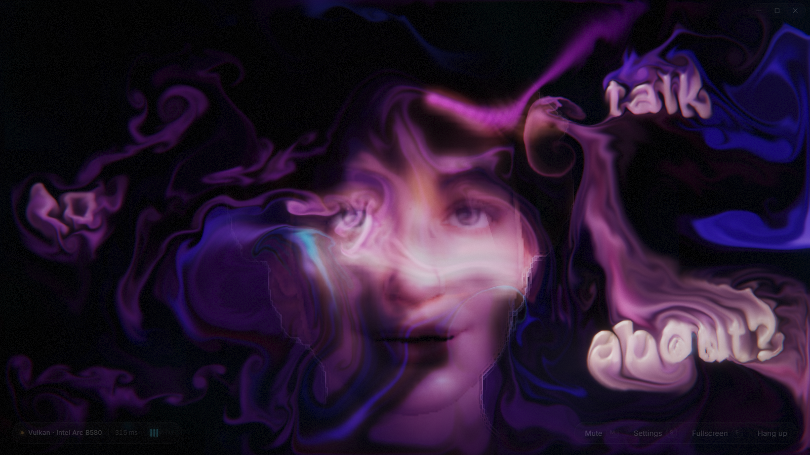
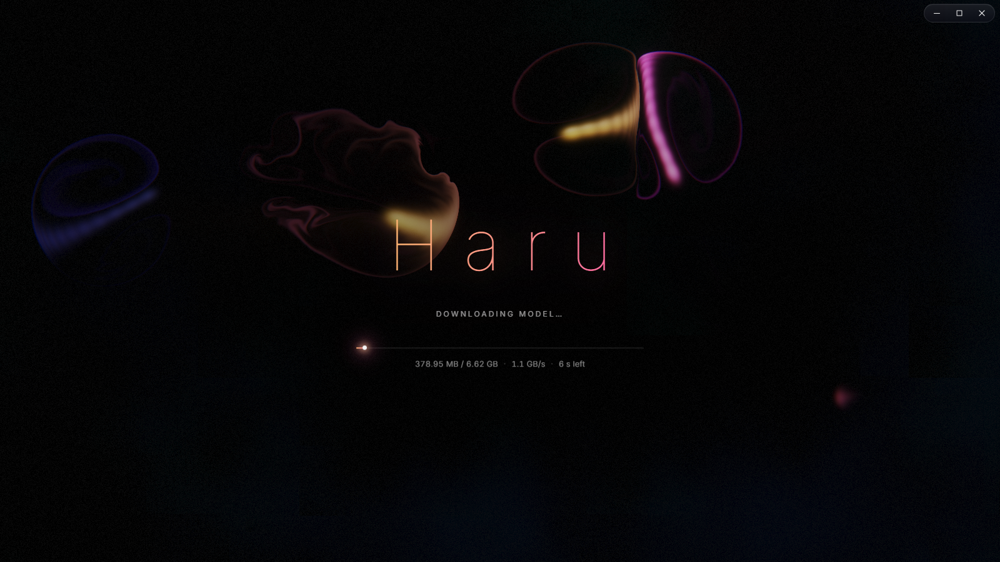
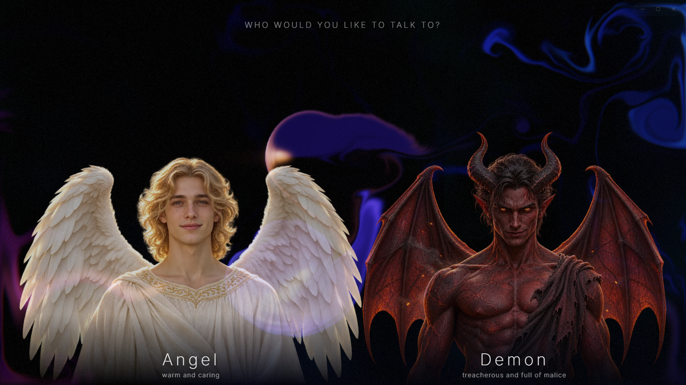
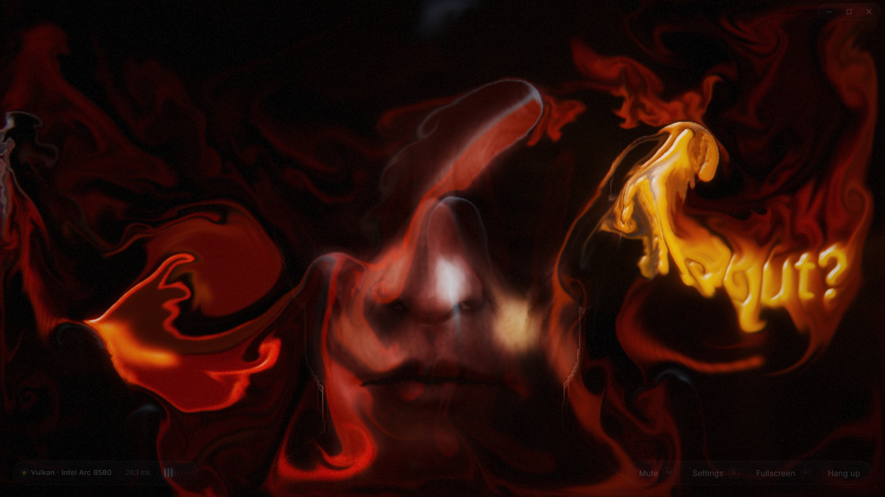
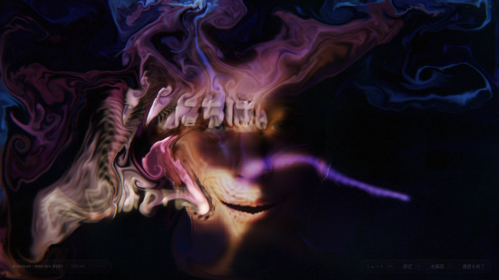
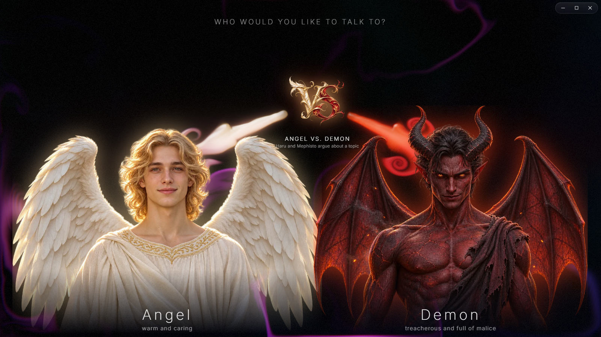
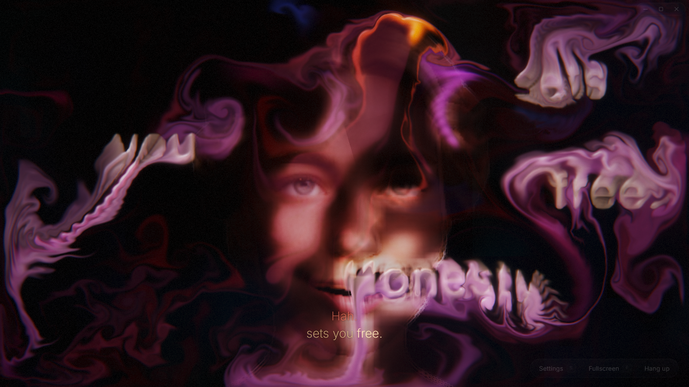
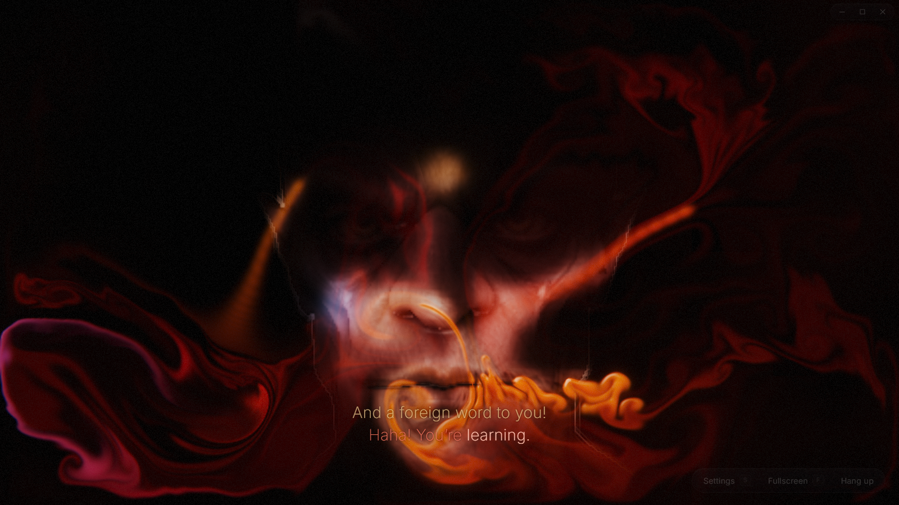

# Haru – Fluid Light

A desktop app for a real-time conversation with the speech model **Haru-4B**. You speak into your microphone, Haru answers with voice, and every word Haru speaks appears as glowing ink in a WebGL2 fluid simulation.

Haru runs locally: the app starts the `speech worker` from [speech.cpp](https://github.com/nyosegawa/speech.cpp) v0.11.1 as a child process and uses the GPU (Vulkan or CUDA), with the CPU as a last resort.



## Features

- **Full-duplex conversation:** You and Haru can speak at the same time. The microphone is sent to the worker in 20 ms blocks, and Haru's reply runs continuously.
- **Echo cancellation:** When playing through speakers, Haru removes its own voice from the microphone signal (sonora, a Rust port of the WebRTC audio processor: AEC3, noise suppression, AGC2, high-pass filter). Interrupting and short interjections such as "mhm" remain possible.
- **Fluid Light:** Haru's words are sprayed as ink into a Stable Fluids simulation, with bloom, god rays, liquid-glass shading and ACES tone mapping.
- **Audio coupling:** Haru's loudness drives swirls and splats, and the spectral centroid drives the hue. Your microphone paints cool splats from the bottom edge while Haru listens.
- **Automatic backend selection** (CUDA, Vulkan, CPU) with the choice shown in the HUD, resumable model download, adaptive render quality, optional subtitles.
- **Language:** One setting controls the UI and the conversation. On first start, Haru takes over the operating system's language. Supported are German, English, Español, Français, 日本語, 한국어, Português, Русский and 中文 (Simplified Chinese). Details under [Language](#language).
- **Duel mode (Angel vs. Demon):** Haru and Mephisto argue with each other about a topic while you watch and listen. No microphone is needed. Details under [Duel: Angel vs. Demon](#duel-angel-vs-demon).

Screenshots:

| Start | Choose a persona | Demon | Japanese |
|---|---|---|---|
|  |  |  |  |

| Duel: start screen | Haru speaks | Mephisto answers |
|---|---|---|
|  |  |  |

## Requirements

**To use it (installer):**

- Windows 10 or 11, 64-bit
- A GPU with **Vulkan 1.3**, or an **NVIDIA GPU with CUDA** (CUDA driver installed), with at least **8 GB** of graphics memory (a duel needs about 1.2 GB more, see [Duel](#duel-angel-vs-demon))
- Headphones or speakers (headphones sound best)
- About **7 GB** of free disk space for the model

**To build from source:**

- Visual Studio 2022 or newer with the C++ toolset
- CMake ≥ 3.20
- Vulkan SDK
- Rust (stable)
- Node.js 20 or newer (CI uses Node 24)
- For the CUDA variant, additionally the CUDA Toolkit 12.x (`CUDA_PATH` set)

## Installation

The finished installers are on [GitHub Releases](https://github.com/antibyte/haru/releases): `Haru_<version>_x64-setup.exe` (with Vulkan) and `Haru_<version>_x64-cuda-setup.exe` (additionally with CUDA, significantly larger) for Windows, `Haru_<version>_amd64.AppImage` and `Haru_<version>_amd64.deb` for Linux, and `Haru_<version>_aarch64.dmg` for macOS with Apple Silicon (see [Releases](#releases)). The Windows installer places the backend variants under `backends\` in the installation folder. The files are not signed; the release text explains how to get past SmartScreen and Gatekeeper and how to run the AppImage without execute permission. A build without a release is available from every run of the `build` workflow as the artifact `haru-windows-x64-nsis`.

Alternatively, build it yourself, see [Build from source](#build-from-source).

## Releases

The installers for a release are built by the workflow `.github/workflows/release.yml` as soon as a tag `v*` is pushed: Windows x64 (two NSIS installers: `Haru_<version>_x64-setup.exe` with Vulkan, and `Haru_<version>_x64-cuda-setup.exe` with Vulkan and CUDA), Linux x64 (AppImage and deb, Vulkan and CPU, built on Ubuntu 22.04), and macOS Apple Silicon (dmg, Metal, ad hoc signed, not notarized). The last job checks that the tag matches the `version` in `app/src-tauri/tauri.conf.json`, and publishes the release "Haru <version>" with all installers, a file with SHA256 checksums, the text from `.github/release-notes.md`, and the changes generated by GitHub. Using "Run workflow" (`workflow_dispatch`), the same workflow builds all installers as artifacts only, without a release.

To create a release:

1. Increase the version in three places, keeping them identical: `version` in `app/src-tauri/tauri.conf.json`, `version` in `app/src-tauri/Cargo.toml` (then run `cargo check --manifest-path app/src-tauri/Cargo.toml` once, which updates `Cargo.lock`), and in `app/package.json` (`npm --prefix app version 0.2.0 --no-git-tag-version` also updates `package-lock.json`).
2. Commit the change and push it to `main`.
3. Set and push the tag:

   ```powershell
   git tag v0.2.0
   git push origin v0.2.0
   ```

If the tag does not match the version in `tauri.conf.json`, the workflow aborts immediately, before anything is built.

## First Start

1. Haru detects the available backends (boot screen).
2. If the model is missing, Haru downloads it (6.6 GB, progress shown as a glowing line with speed and remaining time). Afterwards it is verified (SHA256). Stopping the download is harmless: on the next start, the download continues where it stopped.
3. The model is stored in the speech.cpp cache, together with the speech CLI:

   ```
   %LOCALAPPDATA%\speech.cpp\models\sakasegawa--Haru-4B-GGUF\c372a527e63ca4251429a48863535b8bca03ebd6f414bbf31f28a9d175349934\Haru-4B-Q8_0.gguf
   ```

   An earlier Q6_K file remains in the shared speech.cpp cache. Haru does not delete it; you can remove it by hand. If uninstalling also deletes the model (see Uninstall below), this file is removed as well, since it lies in the same model folder.

   Setting `SPEECH_MODEL_DIR=<absolute path>` (environment variable) replaces the model folder. A relative path is rejected.
4. On the very first start, a notice appears: headphones sound best; over speakers, echo cancellation makes sure Haru does not hear itself. Then press **Start**.

On first start, the UI appears in the operating system's language if it is supported; otherwise in English (see [Language](#language)).

**Uninstall:** At the end, the uninstaller asks whether the Haru model (about 6.6 GB) should also be deleted. The default answer is No. If the model is kept, a new installation does not have to download it again.

Only Haru's model folder is deleted: `%LOCALAPPDATA%\speech.cpp\models\sakasegawa--Haru-4B-GGUF` (or the same folder under `SPEECH_MODEL_DIR`, if set). Other models and the rest of the speech.cpp cache are kept. Empty `models` and `speech.cpp` folders at the default location are removed.

During an update (uninstaller run with `/UPDATE`), it never asks and never deletes the model. Silent (`/S`) and passive (`/P`) uninstalls do not ask either; there, the model is only removed with the parameter `/DELETEMODEL`, for example `uninstall.exe /S /DELETEMODEL`.

The uninstaller's option to delete application data is separate from this: it removes `settings.json` and the app's data folders, but not the model.

The installer replaces the `backends` folder of an existing installation, so switching between the regular and the CUDA installer does not leave an old variant behind.

## Usage

| Key | Function |
|---|---|
| **M** | Mute the microphone (applies to the current and following conversations, not saved; ignored during a duel, which has no microphone) |
| **S** | Open settings |
| **F** | Toggle fullscreen |

The HUD shows the backend badge (e.g. "Vulkan · Intel(R) Arc(TM) B580 Graphics"), latency, microphone level, and buttons for mute, settings and fullscreen.

### Settings

Saved as `settings.json` in the app's config folder (on Windows: `%APPDATA%\dev.haru.fluidlight\settings.json`). Only explicitly set options are passed to the worker.

| Key | Default | Meaning |
|---|---|---|
| `language` | OS language, otherwise `"en"` | Language of the UI and the conversation (the Language field): de, en, es, fr, ja, ko, pt, ru, zh |
| `name` | `"Haru"` | Name Haru uses. Empty or `"Haru"` = the card's name (Japanese: ハル) |
| `gender` | `null` | `"female"` or `"male"` |
| `backchannel` | `null` | Interjections: `"low"`, `"mid"`, `"high"`. `null` = value of the official card (`mid`) |
| `speakFirst` | `true` | Haru starts the conversation |
| `temperature` | `0.7` | Creativity in conversations, 0.3 to 1.0 (higher: Haru talks more and listens less). A settings file from an older version that still holds exactly `0.6` is moved to `0.7` once. |
| `battleTemperature` | `0.8` | Creativity in duels, 0.3 to 1.0 (the slider "Temperature in duels"). Applies from the next duel. |
| `topK` | `25` | Top-k sampling, 0 to 500 |
| `voicePath` | `null` | Optional WAV file for the voice |
| `inputDevice` | `null` | Microphone (`null` = default device) |
| `outputDevice` | `null` | Output device (`null` = default device) |
| `backend` | `"auto"` | `auto`, `cuda`, `vulkan`, `metal`, `cpu` |
| `device` | `"auto"` | `auto`, or a name from `speech devices` (e.g. `Vulkan0`) |
| `quality` | `"auto"` | `auto`, `low`, `medium`, `high`, `ultra` |
| `subtitles` | `false` | Show subtitles |
| `lagLimitSecs` | `1.0` | Lag limit in seconds, 0.5 to 10 |
| `echoCancellation` | `true` | Echo cancellation (remove Haru's voice from the microphone). Takes effect from the next conversation; `false` sends the microphone signal unchanged to the model. If the key is missing in an old `settings.json`, `true` applies. |

Changes to `backend`, `device` or `voicePath` reload the model. Settings that need a reload are refused during a duel, as during a conversation.

### Language

The `language` setting controls the entire UI (start screen, notices, settings, error messages) and the language Haru speaks (character card and conversation). A duel uses the selected language for both cards and for the suggested topics; in Japanese the names are written ハル and メフィスト.

Supported are German (`de`), English (`en`), Español (`es`), Français (`fr`), 日本語 (`ja`), 한국어 (`ko`), Português (`pt`), Русский (`ru`) and 中文 (`zh`, Simplified Chinese).

- **First start:** Without a `settings.json`, or with an unreadable or damaged file (which is then backed up as `settings.json.bad`), Haru takes the first supported language from the operating system's preferred languages. Regional variants count as their base language (`de-AT` → `de`, `pt-BR` → `pt`, `zh-TW` → `zh`). If none of the operating system's languages is supported, Haru uses English.
- **Changing:** After saving in the settings, the UI immediately switches to the new language. A running conversation keeps its language; the new one applies from the next conversation.
- **Saving:** The chosen language is stored in `settings.json` from the first save on, for example when you confirm the headphone notice.

### Character Card

Haru uses the card of the selected persona (see [Personas: Angel and Demon](#personas-angel-and-demon)); in a duel, each persona uses its separate duel card (see [Duel](#duel-angel-vs-demon)). A custom name or a custom backchannel value overrides the card. A custom name also replaces "Haru" in the card texts.

### Conversation Segments

The memory of the model (KV cache) grows with every second of conversation. Before each segment, Haru reads the device's free memory and picks the length: (free memory − 512 MiB for GPU, or 1 GiB for CPU) / 500 kB per second, limited to 120 to 3600 s. On Windows, the free GPU memory comes from the system-wide GPU memory counter (DXGI + PDH); otherwise it comes from the device list of speech.cpp. When a segment ends, Haru automatically starts afresh (without reloading the model), a notice briefly appears at the top, and Haru responds again after one to two seconds. Haru then no longer knows what was said in the previous segment. `HARU_MAX_SECONDS` sets a fixed segment length (for testing only). A duel has no segments: it ends after at most 20 minutes, and nothing renews it.

### Render Quality

Resolutions (simulation / color field): low 128 / 512, medium 192 / 1024, high 256 / 1440, ultra 384 / 2048.

Two controllers work together:

- **Frame-time controller (`auto`):** Adjusts the level to the frame time (moving average): if the frame time is above 20 ms for 2 s, the level drops; if it is below 12 ms for 5 s, the level rises. It pauses while the model budget is throttled, so that throttled frames do not produce wrong values. `auto` never selects `ultra`; it is only set explicitly.
- **Model-first controller** (`ModelFirstController`, `app/src/render/modelfirst.ts`): Only during a conversation. It watches `latencyMs` from the viz frames and throttles rendering so that the model gets the GPU. It caps the level that `auto` or the user has selected and never raises it.

| Tier | Max. level | Render scale | FPS cap | Post effects |
|---|---|---|---|---|
| 0 | none | 1.0 | – | full |
| 1 | high | 0.75 | – | full |
| 2 | medium | 0.75 | 45 | reduced |
| 3 | low | 0.5 | 30 | minimal |

Sequence of the model-first controller:

- Latency above 450 ms for 0.5 s: one tier down, then 1.5 s of rest before the next step.
- Latency above 700 ms for 0.2 s: immediately tier 3.
- Recovery: one tier up when the latency stays below 350 ms for 6 s.

## Personas: Angel and Demon

At start, you choose who Haru is: the angel on the left, the demon on the right. Click, Enter or Space starts the conversation; the arrow keys move the focus. The VS emblem between the two starts a duel instead (see [Duel: Angel vs. Demon](#duel-angel-vs-demon)).

- **Start screen:** The figures are stored as WebP with alpha in `app/public/personas/` (`angel.webp`, `devil.webp`). Prompts and originals are in `assets/personas/<angel|devil>/` (generated with the image tool of the Codex CLI). `scripts/export-personas.py` downsizes them for the app.
- **Character cards:** Each persona has its own card in all 9 languages, embedded from `app/src-tauri/assets/persona-cards/<persona>/<lang>.json`. The official cards in `assets/haru-cards/` remain in the repo as a reference; the app no longer uses them. The free-text "Persona" field is removed.
- **Custom name:** Replaces "Haru" in the card, as before.
- **Limits of the demon:** Contempt, mockery and dark humor are allowed. Excluded are real instructions for harm, calls to self-harm, and hate against groups.
- **Per conversation:** `start_conversation` receives the persona as the argument `persona`. All segments of a conversation keep it. The example `headless_talk` takes the angel unless `HARU_PERSONA=daemon` is set.
- **Demon head:** `app/public/heads/daemon.glb` is a realistic head with a real skin texture (Codex reference image → VARCO 3D → `build_head.py`, see `assets/heads/README.md`). In the composite, the texture replaces the porcelain color; the ink gate remains. Like the demon, the angel shows a realistic, textured angel head (`angel-female.glb` / `angel-male.glb`, female or male depending on the voice).
- **Ember palette:** For the demon, the orbiter and the word ink switch to embers (black-red → crimson → orange → amber). The microphone ink stays cool.
- **Demon voice:** The `DemonVoice` filter (`app/src-tauri/src/audio/voice_fx.rs`) lowers the voice by about 9 semitones (formants −2), mixes in a quiet sub-octave, adds subtle saturation (no growl) and an FDN basement reverb. It adds about 64 ms of latency. A male base voice is forced for the demon. The filter runs before playback, so that echo cancellation sees exactly the signal you hear.
- **A/B comparison:** `HARU_VOICE_FX=off` disables the filter. Offline, on a WAV file: `cargo run --example voice_fx --manifest-path app/src-tauri/Cargo.toml -- in.wav out.wav`.

## Duel: Angel vs. Demon

In a duel, the angel Haru and the demon Mephisto argue with each other about a topic. There is no microphone: you watch and listen. In Japanese the names are written ハル and メフィスト.

### Usage

- **Start:** On the start screen, an ornate "VS" emblem sits between the two figures, with the caption "Angel vs. Demon – Haru and Mephisto argue about a topic". Hovering or focusing it lights up both figures, and two arrows form in the ink, pointing at the two heads. Clicking it opens the topic field.
- **Topic:** The field is prefilled with a random suggestion from 12 curated topics per language: philosophical questions about good and evil, some humorous or sarcastic, e.g. "Does the end justify the means?" or "Is Monday morning proof that the devil exists?". The dice button shows another suggestion. You can also type your own topic (up to 120 characters). Enter or **Start** begins the duel.
- **During the duel:** "Haru and Mephisto are getting ready…" shows while the first seconds are computed. Haru opens, and Mephisto answers. Subtitles, if enabled, are gold for Haru and red for Mephisto, and start a new line at each speaker change.
- **HUD:** Settings, Fullscreen and Hang up. There is no mute button, because there is no microphone.
- **End:** A duel runs until you hang up, at most 20 minutes.

### How it works

- **Shot and reverse shot:** The fog shows the speaker. The shown head switches about 0.7 s after the other voice clearly takes over, and the heads dissolve into each other in 0.6 s. The ink palette changes with the speaker: gold for Haru, red for Mephisto.
- **Voices:** Mephisto's voice uses the same demon voice filter as demon conversations.
- **Lockstep:** Both conversations run on the one loaded Haru-4B model, inside one speech worker process. The worker's `battle` request comes from the local speech.cpp patch `patches/speech.cpp/0001-worker-battle-request.patch`, which the build applies (see [Build from Source](#build-from-source)). The two conversations are stepped in lockstep, 133 ms per frame, and each hears the other's voice from the frame before. The worker's `ready` message lists `"features":["battle"]`; an older worker disables the VS with a hint.
- **Adaptive pre-buffer:** The app measures how fast the GPU computes both voices and waits until enough is buffered: at most 20 s, starting at 3 s. If the GPU is slower than real time, playback pauses briefly in the fog and then resumes. A duel is never aborted for speed.
- **Speed (measured):** On an Intel Arc B580 (Vulkan, Q8_0), one double frame takes 127 ms on average (p50 107 ms) against the 133 ms budget, so duels run about in real time.
- **Cards:** Each persona has a separate duel card in all 9 languages (`app/src-tauri/assets/persona-cards/battle/<angel|daemon>/<lang>.json`). In duels, Mephisto keeps his limits: his malice is pure theatre of words, with no real harm, no hate against groups and no questions about personal matters. These limits are stated in one in-character sentence instead of the chat card's rule list, because the model tended to read rule lists aloud.

### Memory

At the start, the key/value caches of both conversations are reserved for 20 minutes, about 1.2 GB on top of the 6.6 GB model. On 8 GB cards, a duel may not fit and ends with a memory error. Normal conversations are unaffected.

## Backend Selection

The order of attempts (`choose_plan`):

1. **Override first:** `HARU_BACKEND` / `HARU_DEVICE`, otherwise the settings `backend` / `device`.
2. **CUDA**, if the CUDA driver can be reached via `nvcuda.dll` (Windows) or `libcuda.so.1` (Linux) and the `cuda` variant is present. Device: the CUDA device with the most memory.
3. **Vulkan:** the discrete GPU with the most memory, otherwise the integrated GPU.
4. **Metal** (macOS only).
5. **CPU** as a last attempt, with a warning that this is slow.

**8 GB rule:** Haru needs a graphics card with at least 8 GB. Automatic selection only takes devices with at least 7 GiB of reported memory (some 8 GB cards report slightly less than 7.5 GiB via Vulkan). If none is found, Haru runs on the CPU and shows a warning that no graphics card with at least 8 GB was found. A device explicitly selected (`HARU_DEVICE`, settings) remains allowed, but below 7 GiB a warning appears that the conversation may abort. With `HARU_BACKEND=cpu`, only the normal CPU warning is shown.

If an attempt fails (worker crash, device unavailable, no `ready`, no first frame within the timeout), the app tries the next one. If no attempt is left, an error appears with the excerpt from the worker log.

The backend variants are located in `backends\<variant>\speech.exe` (Windows). The app searches for them in this order:

1. Environment variable `HARU_BACKENDS_DIR`
2. Resource folder of the installed app
3. Only in debug builds: `app\src-tauri\backends`

Environment variables:

| Variable | Values | Effect |
|---|---|---|
| `HARU_BACKEND` | `cuda`, `vulkan`, `metal`, `cpu` | Forces the variant (`AUTO` or empty = no override) |
| `HARU_DEVICE` | `auto` or a name from `speech devices`, e.g. `Vulkan0` | Forces the device |
| `HARU_BACKENDS_DIR` | absolute path | Folder containing the variants |
| `HARU_MAX_SECONDS` | seconds, 10 to 3600 | For testing only: fixed length of a conversation segment instead of the calculation from free memory |

Device names are listed by `backends\vulkan\speech.exe devices --json`. The indices (`Vulkan0`, `Vulkan1`) depend on the machine. A specified device that is missing is an error, not a silent fallback.

## Build from Source

### 1. Repository with submodule

```powershell
git clone --recurse-submodules <repo-url>
cd haru
# or, if already cloned:
git submodule update --init --recursive
```

`extern/speech.cpp` (MIT) is a submodule pinned to v0.11.1.

### 2. Build backend variants

```powershell
scripts\build-backends.ps1 -Variants vulkan
# NVIDIA: install the CUDA Toolkit 12.x (CUDA_PATH is set)
scripts\build-backends.ps1 -Variants cuda
```

The result is in `app\src-tauri\backends\<variant>\speech.exe`. The folder is excluded via `.gitignore`.

Before building, the build applies all patches from `patches/ggml/` to the ggml submodule (`extern/speech.cpp/ggml`) and then all patches from `patches/speech.cpp/` to speech.cpp itself (`extern/speech.cpp`) (`git apply`, idempotent: a patch that is already applied is skipped, one that cannot be applied aborts the build). Reason for the ggml patch: the pinned ggml aborts with `GGML_ASSERT(wg0 <= maxComputeWorkGroupCount[0])` when RMS_NORM has more than 65535 rows (Intel GPUs, e.g. when creating a voice from a reference recording); the patch fixes this without needing its own commit in the nested submodule. The speech.cpp patch adds the worker's `battle` request for the battle mode, two conversations of the loaded model that talk to each other; the build also runs its checks `worker-battle-check` and `worker-inbox-check`, which need no model. The patches only change the working directories of the submodules.

### 3. Frontend and app

```powershell
npm --prefix app install
npm --prefix app run tauri dev      # development mode with hot reload
npm --prefix app run tauri build -- --bundles nsis
```

The installer ends up in `app\src-tauri\target\release\bundle\nsis\Haru_<version>_x64-setup.exe`.

### 4. Frontend in the browser (without the Rust core)

The UI can be developed in the browser with a mock client:

```powershell
npm --prefix app run dev
```

| URL | Scenario |
|---|---|
| `http://localhost:5173/?mock` | German conversation with boot, download and replies |
| `http://localhost:5173/?mock=en` | English script and English UI |
| `http://localhost:5173/?mock=ja` | Japanese script and Japanese UI |
| `http://localhost:5173/?mock=error` | Boot error (`noBackend`) with retry |
| `http://localhost:5173/?mock=lag` | Conversation that ends at the lag limit |
| `http://localhost:5173/?mock=slow` | Mock latency rises from 300 to 900 ms (20 s) and falls again (20 s); shows the model-first controller |
| `http://localhost:5173/?debug` | Debug overlay: FPS, GL renderer, quality level, `mf-tier N xSCALE capFPS` |

Further debug parameters: `?quality=<level>` (with `?debug`) fixes the quality and overrides the settings. `?modelfirst=off` (with `?debug`) disables the model-first controller, e.g. for A/B comparisons.

## Tests

```powershell
cargo test --manifest-path app/src-tauri/Cargo.toml --lib   # Rust unit tests
npm --prefix app run test                                    # TypeScript tests (vitest)
```

Echo cancellation is checked synthetically (a speech-like signal, a simulated room with 100 ms reverb and 60 ms delay; attenuation after convergence and double-talk). The real-time simulation through the real microphone pump takes about 8.5 s and only runs on request:

```powershell
cargo test --manifest-path app/src-tauri/Cargo.toml --lib pump_cancels_echo_in_real_time_simulation -- --ignored --nocapture
```

The test `ipc::tests::contract_fixtures_match` and `contract.test.ts` check that Rust and TypeScript serialize and read the same IPC fixtures.

Real worker tests are marked separately:

```powershell
# Against a real speech.exe and the model:
$env:HARU_TEST_SPEECH = "app\src-tauri\backends\vulkan\speech.exe"
cargo test --manifest-path app/src-tauri/Cargo.toml --lib query_real -- --ignored --nocapture

# M0 spike with real worker and model: options are in app/src-tauri/examples/dialogue_smoke.rs
cargo run --release --manifest-path app/src-tauri/Cargo.toml --example dialogue_smoke -- <options>
```

## Architecture

```
 UI (app/src, TypeScript, WebGL2)
   │  invoke · Channel (Viz ~60 Hz, Download) · Event "haru:state"
   ▼
 Rust core (app/src-tauri/src)  session state machine · settings · backend plan · model download
   │  Audio (cpal): microphone → 20 ms blocks      playback ← 24 kHz, resampled
   │  JSON Lines over stdin/stdout
   ▼
 speech worker (child process, backends/<variant>/speech[.exe])
   └─ Haru-4B-Q8_0.gguf on Vulkan, CUDA or CPU
```

The worker runs in its own process. If it crashes, the app tries the next backend.

### Modules

Rust core, `app/src-tauri/src`:

- `lib.rs`, `main.rs`, `commands.rs`: Tauri builder, commands (`#[tauri::command]`)
- `ipc.rs`: IPC contract (states, viz frames, download events)
- `error.rs`, `settings.rs`, `locale.rs`, `paths.rs`, `model_fetch.rs`: errors, settings, operating system language detection, paths, download
- `session.rs`, `session/`: state machine, conversation, microphone pump, frame timeline, latency, viz
- `backend/`: variants, devices, CUDA probe, execution plan
- `worker/`: JSON Lines protocol, PCM codec, process
- `audio/`: devices, capture, playback, resampling, analysis
- Echo cancellation (`audio/aec.rs`): the only module that knows `sonora`. Playback additionally writes every played sample into a reference ring buffer (render tap); the microphone pump (`session/mic_pump.rs`) uses it to clean every 20 ms block before the level display and the worker see it. On an error, it falls back to the raw signal for the rest of the conversation and warns once.
- `test_hooks.rs`: test environment variables (see below)

UI, `app/src` (TypeScript):

- `main.ts`, `app.ts`: start, connection of client, renderer and overlays
- `ipc/`: contract types, Tauri client, mock client
- `gl/`, `fluid/`, `post/`, `render/`: WebGL2, Stable Fluids simulation, post effects, quality controllers
- `words/`, `audio/`: word paths and injection, audio coupling
- `ui/`: overlays and `strings.ts` (UI texts in all supported languages)

## Performance (Measured)

Measured with `dialogue_smoke` (M0, measured with Q6_K, German test question, details in `docs/m0-feasibility.md`). Compute time per frame; one frame covers 133 ms of audio:

| Device | Mode | p50 | p90 | Over 133 ms | Verdict |
|---|---|---|---|---|---|
| Intel Arc B580 (Vulkan) | lockstep | 34.8 ms | 68.2 ms | 1 of 95 (early frame) | PASS |
| Intel Arc B580 (Vulkan) | real time | 35.4 ms | 56.0 ms | 0 | PASS |
| Intel UHD (iGPU, Vulkan) | lockstep | 370.6 ms | 440.3 ms | 94 | too slow |
| CPU (i7-11700B) | lockstep | 419.8 ms | 656.9 ms | 64 | too slow |

In the real-time run on the B580, playback never fell behind. The app warns for iGPU and CPU, because they are well below real time. The measurement runs without the UI. In operation, the model-first controller throttles the display as soon as latency rises above 450 ms (see Render Quality).

## Troubleshooting

**Conversation ends with "Haru can’t keep up"**
The lag has risen above `lagLimitSecs` (default 1.0 s), usually because the GPU is too slow or fully loaded. The warning threshold is 0.5 s; at the limit, the app ends the conversation.
- The model-first controller automatically throttles the UI when latency is high (see Render Quality). This gives the model more GPU time; the model's own compute time does not decrease.
- Close other GPU applications (games, video rendering, browsers with hardware acceleration).
- Set `quality` to `low` or `medium` to relieve the UI from the start.
- Use `HARU_DEVICE` or the settings to choose the faster GPU if the HUD shows an iGPU or CPU.

**Remote Desktop (RDP): slow or stuttering**
The display driver of the RDP session competes with the worker for the same GPU. Keep the window smaller or run the app locally.

**"No backend variant found"** (`noBackend`)
The variant is missing from the folder `backends\<variant>\speech.exe`. Build it with `scripts\build-backends.ps1 -Variants vulkan` (or `cuda`), or set `HARU_BACKENDS_DIR` to a folder with ready-made variants.

**No backend starts, the message shows a worker error**
The worker log is in `%LOCALAPPDATA%\dev.haru.fluidlight\logs\worker-*.log`. The latest log belongs to the failed attempt. Common causes: device not present (`device`), too little memory (`out_of_memory`), damaged model (`model_file`; then delete the file, and the download runs again).

**No microphone**
Windows privacy settings (Settings → Privacy & security → Microphone) must allow desktop apps access. Check the input device in Haru's settings, or set `inputDevice` to `null`.

**Download aborts**
Restart the app. The download continues from the `.part` file. A hash error downloads the model again.

**Haru hears itself (echo)**
Check whether echo cancellation is on in the settings (it takes effect from the next conversation). If strong residual echo remains, for example at very loud playback, or when Windows sound enhancements or drivers process the microphone additionally, headphones help. If a warning that echo cancellation is unavailable or has failed appears, the conversation continues with the raw signal.

## Test and Development Environment Variables

Read in `app/src-tauri/src/test_hooks.rs`. Without these variables, the app behaves normally.

| Variable | Effect |
|---|---|
| `HARU_TEST_WAV=<path>` | This WAV file replaces the microphone. It plays in real time from the start of the conversation, then silence. Playback still goes to the real output device, unless `HARU_TEST_NO_PLAYBACK=1` is set. Echo cancellation is off in this case (no real reference). |
| `HARU_TEST_NO_PLAYBACK=1` | Haru's audio goes to a virtual sink (silent run). Also works without a WAV; then the real microphone is used. |
| `HARU_TEST_AUTOSTART=1` | The UI closes the headphone notice and presses Start itself after launch. |
| `HARU_TEST_DEBUG=1` | Enables the `?debug` overlay and writes GL renderer, FPS and state to stderr. |
| `HARU_TEST_NO_RENDER=1` | Stops the WebGL render loop (together with `HARU_TEST_DEBUG`). Separates the GPU load of the UI from the lag in the core. |
| `HARU_TEST_QUALITY=<level>` | Fixes the render quality (`low`, `medium`, `high`, `ultra`) and overrides the settings. Only works together with `HARU_TEST_DEBUG`. |

## Porting

- **Linux:** `bash scripts/build-backends.sh vulkan` (default is `vulkan cpu`). The CUDA probe loads `libcuda.so.1`; the worker gets its binary directory in `LD_LIBRARY_PATH`. The `linux` job of the CI tests and builds the Vulkan variant as a portability check. The release workflow builds the AppImage and deb (Vulkan and CPU), see [Releases](#releases).
- **macOS:** `bash scripts/build-backends.sh metal` (default on Darwin, with `-DGGML_METAL_EMBED_LIBRARY=ON`). The release workflow builds a dmg for Apple Silicon (from macOS 13.3, `bundle.macOS.minimumSystemVersion`); not tested on real hardware.

## Licenses

- **Haru application:** The project license has not been chosen yet.
- **speech.cpp** (submodule `extern/speech.cpp`): MIT.
- **Haru-4B** (model weights, `sakasegawa/Haru-4B-GGUF`): Apache-2.0. Haru-4B is a research model.
- **sonora** (Rust port of the WebRTC audio processor, echo cancellation): BSD-3-Clause.
- **Inter Variable** (font, `@fontsource-variable/inter`): SIL Open Font License 1.1.

## Known Limitations

- **CUDA variant:** Only built in CI. It is not tested on real hardware, because CI has no GPU. If it fails, the fallback chain switches to Vulkan or CPU.
- **Echo cancellation:** Checked synthetically (attenuation, double-talk, real-time simulation). The practical test with speakers is still pending and is up to the user. Noise suppression and automatic gain control change what the model hears (as in the browser).
- **Model behavior with synthetic voices:** With an artificial voice (e.g. a SAPI test file), answers come out short and sometimes incoherent. This is due to the model, not to compute time.
- **Platforms:** Measured only on Windows 11 with an Intel Arc B580. Linux and macOS are set up only as portability targets. iGPU and CPU are not sufficient for real time.
- **Duel behavior:** The small speech model sometimes introduces itself, repeats lines from its card, narrates instead of talking, drifts off topic, or slips into podcast or show-host phrases.
- **Duel texts:** The duel texts in languages other than German and English have not been reviewed by native speakers.
- **Duel memory:** On 8 GB cards, a duel may not fit and ends with a memory error (see [Memory](#memory) in the Duel section).
